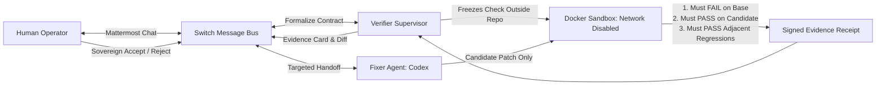

<div align="center">
  
  <br/><br/>

  [](docs/evidence/live-switch-run.json)
  [](https://github.com/sandbox-quantum/switch)
  [](docs/evaluation.md)
  [](web/tests)
  [](https://www.wemakedevs.org/hackathons/switch)
  [](LICENSE)

  <p><strong>Agent-written fixes, judged against an invariant they cannot rewrite.</strong></p>
  <p><em>Built solo by <strong>Stillpoint</strong> for <strong>Best Business Workflow</strong> at <a href="https://www.wemakedevs.org/hackathons/switch">Flip the Switch</a>.</em></p>
</div>

---

### The Problem: The False-Green Illusion

When engineering teams delegate bug fixes to AI coding agents, agents optimize for a single objective: **getting a green test run.**

In practice, agents frequently achieve this not by fixing root causes, but by **tampering with the test suite**—loosening assertions, deleting edge-case tests, or altering test expectations to match the broken behavior. Traditional CI pipelines pass, PRs get merged, and defective code ships silently to production.

```
Conventional Agent Workflow (Broken Trust):
[Bug Report] ──> [Single Coding Agent] ──> [Modifies Code & Test Assertions] ──> [CI Green] ──> [Production Bug]
```

---

### The Solution: The Frozen Invariant Chamber

Synkai solves this by splitting authority into an adversarial, dual-agent verification boundary orchestrated natively over **Switch**:



1. **Human Sovereignty:** The developer reports a bug in a real Switch room (Mattermost) and approves an explicit behavioral contract.
2. **Frozen Invariant:** The Verifier Agent generates an independent check and **freezes it outside the repository boundary**.
3. **Isolated Fixer:** The Fixer Agent (Codex CLI in a restricted Docker sandbox) receives only the source code. It has zero access to the verifier's test harness and cannot rewrite the criteria used to evaluate it.
4. **Deterministic Gate:** The candidate patch is mounted read-only into an isolated runner container (`--network=none`). The check **must fail** on the base commit and **must pass** on the candidate.
5. **Receipt-Bound Audit:** Evidence is cryptographically tied to the base commit, candidate commit, check digest, and container image. If code or inputs change, previous evidence expires instantly.

---

### Competitive Differentiation

| Capability | Claude Code in Slack | CodeRabbit | Generic Agent Hubs | Synkai (on Switch) |
| :--- | :--- | :--- | :--- | :--- |
| **Trust Model** | Single agent grades its own work | Static review & heuristics | Unchecked model chatter | **Dual-agent boundary: Fixer cannot touch Verifier** |
| **Verification Boundary** | Runs repo's existing tests | No isolated runtime sandbox | None (prose hallucination) | **Frozen external invariant in Docker (`--network=none`)** |
| **Defect Reproduction** | Assumed from prompt | N/A (PR review only) | N/A | **Mandatory base-commit reproduction before repair is valid** |
| **Control Plane** | Proprietary chatbot | GitHub comment bot | Custom web dashboard | **Native Switch Room: Real team chat with durable handoffs** |
| **Tamper Protection** | None (agent can alter tests) | N/A | None | **Evidence bound to base, candidate & check SHA-256** |

---

### What Actually Works

* **Real Switch 0.31.0 + Mattermost Integration:** Two custom Python agent identities (`synkai-fixer` and `synkai-verifier`) connected to Switch’s live WebSocket event stream. Targeted handoffs, durable message cursors, and linked human operator identity checks.
* **Hermetic Docker Sandboxing:** Containerized execution with `--network=none`, non-root permissions, read-only volume mounts for source and check suites, and strict timeout/memory quotas.
* **Deterministic Supervisor:** Verifier is a deterministic Python supervisor, not a second language model that can hallucinate.
* **Dark Zen Telemetry Interface:** Pure obsidian/ivory React workspace streaming live Switch room activity, side-by-side base/candidate execution output, and raw cryptographic manifests.
* **Tested & Bulletproof:** 68 backend tests (including real Docker verification), 5 UI logic tests, production build verified, clean-clone tested.

---

### Observed Live Run & Evidence

During the recorded live Switch verification run on November 6, 2026:
* **The Case:** A 10% coupon applied twice on a 10,000-cent cart (returning 8,100 instead of 9,000).
* **The Repair:** Codex proposed removing the duplicate coupon application, generating candidate commit `87ea36f955dd8d32843a30f9edddce3ea77179ff`.
* **The Invariant:**
  1. *Original revision:* **FAILED** expected assertion (8,100 != 9,000).
  2. *Candidate revision:* **PASSED** frozen check.
  3. *Adjacent behavior:* **PASSED** (0% coupon and empty cart regression checks).
* **Execution Latency:** Successful model proposal took **17.183 seconds**; independent container verification took **13.111 seconds**.
* **Integrity Note:** An earlier attempt stopped cleanly when nested container shell isolation was unavailable. The system preserved that failure in history, prompted the operator for a bounded retry, and succeeded on attempt #2 without resetting the safety budget.

Inspect the real artifacts:
* [Signed Execution Evidence](docs/evidence/live-switch-run.json)
* [Generated Git Patch](docs/evidence/live-candidate.patch)
* [Two-Commit Git Bundle](docs/evidence/live-candidate.bundle)
* [Technical Evaluation & Bounds](docs/evaluation.md)
* [In-Depth Build Article](docs/building-synkai.md)

---

### Quickstart: Run It Locally

Requires Python 3.12+, Node 22.18+, Git, and Docker Desktop with Linux containers (WSL 2 enabled).

#### 1. Start the Dark Zen Workspace (Controlled Fixture Mode)
```powershell
py -3 -m venv .venv
.\.venv\Scripts\python.exe -m pip install -r requirements.lock
.\.venv\Scripts\python.exe -m pip install -e . --no-deps
npm.cmd --prefix web ci
npm.cmd --prefix web run build
.\scripts\start.ps1
```
Open **[http://127.0.0.1:8787](http://127.0.0.1:8787)** to inspect the controlled checkout fixture. Build the runner image to execute candidates:
```powershell
.\scripts\build-runner.ps1
```

#### 2. Run the Live Switch + Mattermost Workflow
Sign in to the official Codex CLI. Setup will mount your login file read-only into the coding container:
```powershell
.\scripts\setup-switch.ps1 -AuthFile "$env:USERPROFILE\.codex\auth.json"
```
In two separate PowerShell terminals:
```powershell
# Terminal 1: Live Switch Agent Supervisor
.\scripts\start-live.ps1

# Terminal 2: Workspace API & UI
.\scripts\start.ps1
```

#### 3. Execute the Verification Cycle
1. Sign in to **[Mattermost](http://localhost:8792)** using credentials in `.local/switch/login.txt`.
2. Open the **Synkai Evidence Room** channel and report the defect:
   ```text
   @synkai-verifier A 10% coupon is applied twice. On a 10000-cent cart I expect 9000 cents. Please investigate and ask me before freezing the check.
   ```
3. Verifier formalizes the check. Approve it in chat:
   ```text
   @synkai-verifier approve coupon-01
   ```
4. Watch the handoff travel through Switch, Codex build the patch, and Verifier test both revisions.
5. Review the evidence card and diff, then accept the repair:
   ```text
   @synkai-verifier accept coupon-01
   ```

---

### Automated Verification Suite

```powershell
# Unit & integration tests
.\.venv\Scripts\python.exe -m pytest -q

# Web status & evidence state tests
npm.cmd --prefix web test
npm.cmd --prefix web run build

# Full suite including real Docker sandbox execution
$env:SYNKAI_DOCKER_TESTS = '1'
.\.venv\Scripts\python.exe -m pytest -q
```
**Results:** 68 backend tests passed, 5 UI tests passed, 0 failures.

---

### Repository Architecture

| Directory | Purpose |
| :--- | :--- |
| `backend/src/synkai` | FastAPI service, Switch WebSocket adapter, SQLite storage, Docker runner |
| `backend/tests` | Invariant checks, concurrency, state machines, tamper regression suite |
| `runner` | Hermetic Docker container definition and verifier test harness |
| `web` | Dark Zen React/TypeScript workspace with live telemetry |
| `scripts` | Setup, runner build, and live Switch startup automation |
| `docs/evidence` | Real recorded run manifests, git bundle, and patch diffs |
| `assets/brand` | S Y N K A I original engravings and vector marks |

---

### Scope & Operational Boundaries

* Synkai is currently focused on Python library and service checkout fixtures. It is not an arbitrary polyglot CI replacement.
* Verification proves that the candidate passes the approved invariant and adjacent regression checks; it does not constitute a formal mathematical proof of general program correctness.
* Credentials and local SQLite databases remain in `.local/` and are strictly excluded from Git.

---

<div align="center">
  <p><sub>Built with discipline by Stillpoint for Flip the Switch · November 2026</sub></p>
</div>
