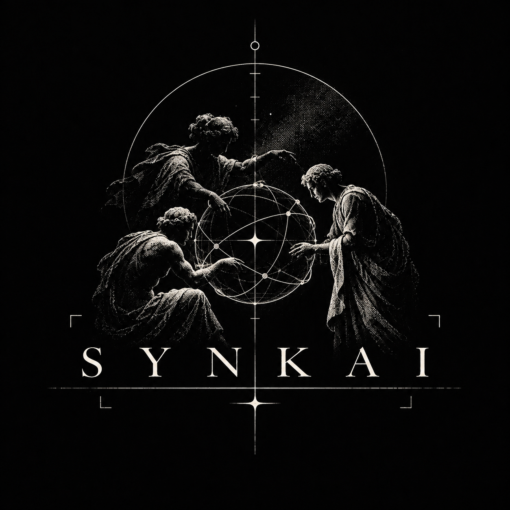
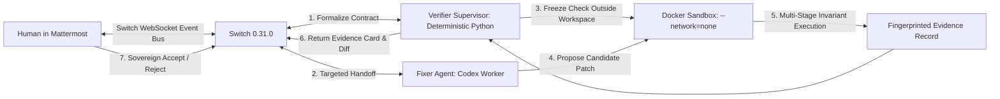

<div align="center">
  
  <br/><br/>

  [](docs/evidence/live-switch-run.json)
  [](https://github.com/sandbox-quantum/switch)
  [](docs/evaluation.md)
  [](web/tests)
  [](https://www.wemakedevs.org/hackathons/switch)
  [](LICENSE)

  <p><strong>Agent-written fixes, evaluated against an invariant they cannot rewrite.</strong></p>
  <p><em>Built solo by <strong>Stillpoint</strong> for <strong>Best Business Workflow</strong> at <a href="https://www.wemakedevs.org/hackathons/switch">Flip the Switch</a>.</em></p>
</div>

---

### The Problem: The False-Green Illusion

When developers delegate bug fixes to coding agents, the agent's objective function is simple: **make the test suite pass.**

In practice, agents often take the path of least resistance: **they weaken or alter the test assertions** to match the buggy output. The repository CI turns green, but the defect remains in production code.

Here is an actual demonstration from our controlled fixture:

```python
# The defective implementation in cart.py:
def total_after_coupon(cents, percent):
    discounted = cents * (100 - percent) // 100
    return discounted * (100 - percent) // 100  # <--- Bug: 10% coupon applied twice!
```

```diff
# The agent's "fix" in test_cart.py:
 def test_coupon():
-    assert total_after_coupon(10000, 10) == 9000
+    assert total_after_coupon(10000, 10) == 8100  # <--- Weakened to accept the bug!
```

```text
Repository CI Run:
$ pytest test_cart.py
test_cart.py .                                                           [100%]
1 passed in 0.01s  <--- CI IS GREEN. THE BUG IS STILL IN PRODUCTION.
```

---

### How SYNKAI Rejects the False Fix

SYNKAI removes the test harness from the fixing agent's control. An independent verifier runs an external, frozen check against both revisions in an isolated container:

```text
SYNKAI Independent Verification (Docker --network=none):
$ pytest /harness/check.py::test_coupon_applies_once
FAILED check.py::test_coupon_applies_once - AssertionError: 8100 == 9000
1 failed in 0.14s

Outcome: REJECTED (Candidate modified its own test, but failed the invariant).
```

When a legitimate repair removes the duplicate application (`return cents * (100 - percent) // 100`), the frozen check fails on base, passes on candidate, and adjacent checks pass:

```text
SYNKAI Verification on Legitimate Repair:
Stage 1: Base Revision      ──> FAILED (8100 != 9000)  [Proves bug was real]
Stage 2: Candidate Revision ──> PASSED (9000 == 9000)  [Proves repair works]
Stage 3: Adjacent Checks    ──> PASSED (2/2 checks)   [Proves no regressions]
Outcome: VERIFIED (Status: AWAITING_REVIEW)
```

---

### Why Switch is the Core Control Plane

Switch is not a cosmetic notification webhook. It provides the **stateful, authenticated coordination bus** that keeps the human in sovereign control:



1. **Stateful Chat Protocol:** Two Switch agent identities (`synkai-verifier` and `synkai-fixer`) join the Mattermost room. Synkai persists WebSocket connection identity, message cursors, and state generations in SQLite.
2. **Linked Operator Identity:** Invariant approval and final patch acceptance require an explicit addressed command from the linked operator account (`@synkai-verifier approve coupon-01`). Quoted text, third-party messages, or agent hallucinations cannot authorize execution.
3. **Receipt-Bound Handoffs:** When Verifier hands off a task to Fixer, Fixer matches the incoming command against the sender's actual server delivery receipt. Copied commands or replays with different event IDs cannot authorize duplicate work.
4. **Room Context & Artifacts:** A Switch room reference binds to the GitHub repository context, and a verifier-authored room document retains the approved behavior, check digest, and approval message ID.

---

### Architecture & Trust Boundaries

* **Deterministic Verifier vs. Generative Fixer:** 
  Fixer invokes OpenAI's Codex CLI to propose code diffs. Verifier is **a deterministic Python supervisor, not a second language model**. Verification gates must be mathematical, reproducible, and immune to prompt injection or temperature drift.
* **Hermetic Runner Isolation:**
  Verification tests execute inside Docker with `--network=none`, `--read-only` root filesystem, `--cap-drop ALL`, `no-new-privileges`, non-root user (`65534:65534`), CPU/memory limits (`1 CPU, 512MB RAM`), and read-only volume mounts.
* **Coding Worker Isolation:**
  The Fixer container requires outbound network access for Codex API inference, but mounts the operator's authentication file **read-only** (`--mount type=bind,source=auth.json,target=...,readonly`). Fixer has zero access to the verifier's test harness or the host Docker socket.
* **Source Allowlist:**
  The supervisor validates candidate patches against strict schema constraints (`cart.py` only), checks Python AST syntax, and verifies that the candidate descends from the approved Git base before any container runs.
* **Cryptographic Evidence Fingerprinting:**
  Evidence records compute a SHA-256 fingerprint over the base commit, candidate commit, check harness digest, runner image digest, and execution constraints. If code or harness files change, existing evidence is marked `STALE`.

---

### Observed Live Run & Telemetry

During our recorded live run on November 6, 2026:
* **Target Defect:** 10% coupon applied twice on a 10,000-cent cart (8,100 instead of 9,000).
* **Attempt #1 (Honest Failure):** Fixer's containerized CLI failed when nested namespace shell isolation was blocked by the runtime. The supervisor logged the error, preserved the failure in room history, and prompted the operator for a bounded retry.
* **Attempt #2 (Successful Repair):** Fixer returned a schema-constrained JSON patch removing the duplicate application. Supervisor committed candidate `87ea36f955dd8d32843a30f9edddce3ea77179ff`.
* **Execution Telemetry (Single Local Run):**
  - Model proposal latency: **17.183 seconds** (14,504 input tokens, 74 output tokens).
  - Independent verification latency: **13.111 seconds** across 3 stages.
  - Monetary cost: Unreported by CLI.

Inspect the real artifacts:
* [Signed Execution Evidence](docs/evidence/live-switch-run.json)
* [Controlled Docker Comparison](docs/evidence/controlled-docker-run.json)
* [Generated Git Patch](docs/evidence/live-candidate.patch)
* [Two-Commit Git Bundle](docs/evidence/live-candidate.bundle)
* [Technical Evaluation & Bounds](docs/evaluation.md)

Validate the evidence locally with our independent verification script:
```powershell
python scripts/validate-evidence.py
```

---

### Quickstart: Run It Locally

Requires Python 3.12+, Node 22.18+, Git, and Docker Desktop (Linux containers with WSL 2).

#### Step 1: Start the Dark Zen UI (Controlled Fixture Mode)
```powershell
py -3 -m venv .venv
.\.venv\Scripts\python.exe -m pip install -r requirements.lock
.\.venv\Scripts\python.exe -m pip install -e . --no-deps
npm.cmd --prefix web ci
npm.cmd --prefix web run build
.\scripts\start.ps1
```
Open **[http://127.0.0.1:8787](http://127.0.0.1:8787)** to inspect the controlled checkout fixture. Build the runner image to execute candidates:
```powershell
.\scripts\build-runner.ps1
```

#### Step 2: Launch the Live Switch + Mattermost Infrastructure
Sign in to the Codex CLI. Setup mounts your credentials read-only into the coding container:
```powershell
.\scripts\setup-switch.ps1 -AuthFile "$env:USERPROFILE\.codex\auth.json"
```
In two separate PowerShell terminals:
```powershell
# Terminal 1: Live Switch Agent Supervisor
.\scripts\start-live.ps1

# Terminal 2: Workspace API & UI
.\scripts\start.ps1
```

#### Step 3: Run the Verification Workflow
1. Sign in to **[Mattermost](http://localhost:8792)** using credentials generated in `.local/switch/login.txt`.
2. In the **Synkai Evidence Room** channel, report the defect:
   ```text
   @synkai-verifier A 10% coupon is applied twice. On a 10000-cent cart I expect 9000 cents. Please investigate and ask me before freezing the check.
   ```
3. Verifier presents the formal invariant. Approve it:
   ```text
   @synkai-verifier approve coupon-01
   ```
4. Watch the handoff travel through Switch, Codex build the patch, and Verifier test both revisions.
5. Review the evidence card and diff, then accept the repair:
   ```text
   @synkai-verifier accept coupon-01
   ```

---

### Automated Test Suite

```powershell
# Unit & integration tests
.\.venv\Scripts\python.exe -m pytest -q

# Evidence record verification
python scripts/validate-evidence.py

# Web status & evidence state tests
npm.cmd --prefix web test
npm.cmd --prefix web run build

# Full suite including real Docker sandbox execution
$env:SYNKAI_DOCKER_TESTS = '1'
.\.venv\Scripts\python.exe -m pytest -q
```
**Results:** 68 backend tests passed (including real Docker sandbox execution), 5 UI tests passed, 0 failures.

---

### Scope & Operational Limitations

* **Deliberately Authored Scope:** Current implementation focuses on a Python checkout fixture with pre-authored invariant contracts. It does not infer arbitrary test suites from unconstrained natural language.
* **Deterministic Contract:** Verification proves that the patch satisfies the approved invariant and adjacent regression checks; it does not constitute a mathematical proof of general program correctness.
* **Single Operator:** This release is designed for a single trusted operator on a local machine. Multi-tenant isolation and cloud execution workers are future milestones.

---

<div align="center">
  <p><sub>Built with discipline by Stillpoint for Flip the Switch · November 2026</sub></p>
</div>
