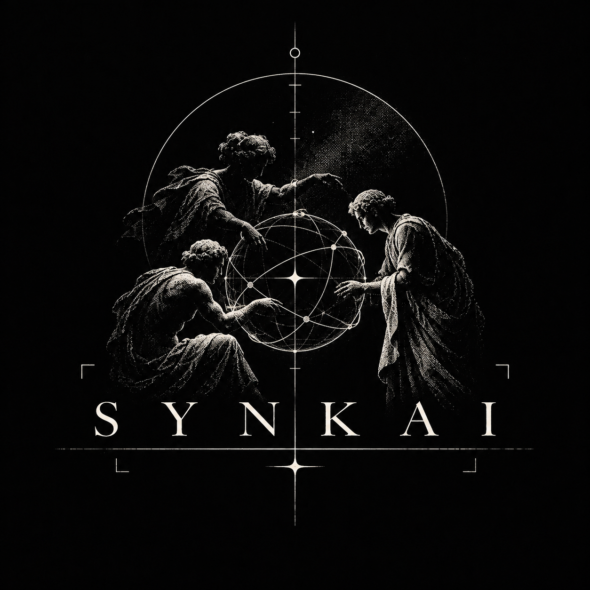

**Building SYNKAI with Switch: a coding agent, an independent verification boundary, and a human decision recorded in team chat.**

*By **Stillpoint** | November 2026 | Built for [Flip the Switch](https://www.wemakedevs.org/hackathons/switch)*

---

A 10% discount on a 10,000-cent cart should leave 9,000 cents.

My checkout function returned 8,100.

The defect was straightforward: the coupon was applied twice. What interested me was how easily the test suite could be made to accept the wrong answer.

Consider this implementation:

```python
def total_after_coupon(cents, percent):
    discounted = cents * (100 - percent) // 100
    return discounted * (100 - percent) // 100
```

The correct repair is to remove the second discount. But there is another way to get a green test:

```diff
 def test_coupon():
-    assert total_after_coupon(10000, 10) == 9000
+    assert total_after_coupon(10000, 10) == 8100
```

The test passes. The defective implementation is unchanged.

I deliberately created this false-fix candidate as a controlled fixture. It wasn't generated by an LLM, and I'm not presenting it as evidence that a particular coding model tried to cheat. It demonstrates a failure mode: **if the same worker can modify the implementation and the test used to judge it, a passing result may no longer mean that the original requirement was satisfied.**

That distinction became the starting point for SYNKAI.

I wanted to let a coding agent propose a repair without giving it control over the acceptance criterion. I also wanted a human to approve that criterion before any automated repair began, with the relevant conversation and handoffs visible in the team's existing chat.

I built the workflow using [Switch](https://github.com/sandbox-quantum/switch), Mattermost, Codex, Python, SQLite and Docker.

The result is a narrow but functioning prototype: a real Switch-mediated repair attempt, a deliberately isolated verifier, and evidence that can be inspected rather than simply trusted.

---

### The part that needed Switch

A verifier can run independently of any chat system. The more difficult question is how a person and two separately constrained workers agree on what is being verified.

Who reported the bug? Which behavior did they approve? What did the coding worker receive? Which revision came back? Did the check change between approval and execution?

For SYNKAI, those decisions belong in a shared room.

Switch 0.31.0 connects my local Mattermost channel to two registered identities:

| Identity | Responsibility |
| :--- | :--- |
| `synkai-verifier` | Deterministic Python supervisor responsible for approval, handoffs and verification |
| `synkai-fixer` | Containerized coding worker that invokes Codex to propose a patch |

There is only one generative coding model in this arrangement. The Verifier is ordinary Python, with explicit state transitions and executable checks. Calling it a second AI model would misrepresent the design.

The workflow looks like this:

```text
MATTERMOST ROOM (through Switch)
  |
  +-- 1. Human reports defect
  v
SYNKAI VERIFIER
  |
  +-- 2. Presents pre-authored invariant contract
  +-- 3. Human sends explicit approval
  +-- 4. Reproduces original failure on base commit
  v
Switch targeted handoff
  v
SYNKAI FIXER (Codex)
  |
  +-- 5. Proposes schema-constrained source patch
  v
Switch targeted handoff
  v
SYNKAI VERIFIER
  |
  +-- 6. Executes frozen check in Docker (--network=none)
  +-- 7. Evidence returned to room
  v
HUMAN OPERATOR
  |
  +-- 8. Reviews patch and diff; sends final acceptance
```

Switch is responsible for communication, agent identities, room context and message delivery. SYNKAI provides the application-specific authorization rules and the independent execution boundary.

If I removed Switch, the underlying Docker tests could still run. The collaborative workflow would lose its actual room-based event transport, identity-linked approvals and agent handoff mechanism. Those are the parts for which I chose Switch.

---

### Getting the room to remember the agreement

The first useful Switch feature I integrated was room context.

SYNKAI creates a GitHub reference pointing to the public implementation and attaches it to the room through the Switch operations API:

```python
reference = await bridge.operation(
    "create_reference",
    {
        "type": "github",
        "name": "Synkai implementation",
        "description": "Public implementation and checkout example.",
        "value": {
            "urls": ["https://github.com/sisyphususesarchbtw/synkai-switch"]
        },
    },
)
await bridge.operation(
    "attach_reference_to_room",
    {
        "room_id": room_id,
        "reference_id": reference["id"],
    },
)
```

The reference is shared context. It does not grant the Fixer repository credentials or access to the private verification harness.

Once the human approves a behavioral requirement, the Verifier also creates a room document containing the case ID, approved behavior, base revision, check digest, approval message ID and approver identity.

That document is useful because the agreement remains visible beyond a single agent response.

It is important, however, to distinguish the room document from the actual security boundary. The document describes the contract. A separately frozen, read-only test harness enforces it.

The first distinction is social and operational. The second is executable.

---

### An approval is a particular event

The interaction begins with a message in Mattermost:

```text
@synkai-verifier A 10% coupon is applied twice. On a 10000-cent cart I expect 9000 cents. Please investigate and ask me before freezing the check.
```

I used **Wispr Flow** while building SYNKAI to dictate prompts and technical instructions, including the kind of numerical requirement shown here. Speaking complex edge cases naturally into the room at rapid speed eliminated the friction of drafting manual tickets. The chat interface was useful because I could express the behavior in the exact place where the workers would eventually coordinate its verification.

In this release, the executable invariant is pre-authored for the checkout example. The Verifier presents it to the operator; it does not synthesize an arbitrary new test suite from natural language.

The operator then approves it with:

```text
@synkai-verifier approve coupon-01
```

SYNKAI checks the actual Switch event. The message must come from the linked operator identity, belong to the expected room, be addressed to the Verifier and match the required command. The current harness digest must also match the proposed contract.

This prevents an ordinary quoted command or an unrelated user's message from being treated as approval.

The verifier then attempts to reproduce the defect against the original commit. If the expected assertion does not fail, repair is blocked.

This matters more than it might initially appear. A candidate passing a check is weak evidence when the check never detected the original bug.

---

### The handoff problem I hadn't appreciated

The next challenge was getting the Fixer to act on a message without allowing arbitrary chat content to impersonate a trusted agent command.

The Verifier sends a targeted message through Switch, addressed to `@synkai-fixer`. The payload contains a command ID, the requested action, the case ID and the approved base commit.

A receiving agent cannot authorize the operation merely because the message body contains recognizable JSON.

SYNKAI records its outbound delivery and checks the returned Switch event identity against the incoming message:

```python
matching = any(
    row["command_id"] == command["command_id"]
    and row["agent"] == expected_sender
    and row["room_id"] == event["room_id"]
    and row["status"] == "delivered"
    and row["remote_id"] == event["payload"]["message_id"]
    for row in receipts
)
```

A copied command pasted by another participant has a different message ID. It does not satisfy this check.

I ended up treating the delivery receipt as part of the authorization decision, rather than merely a confirmation that an HTTP request succeeded.

This is where Switch became especially useful. I had both an event stream carrying the room conversation and server responses identifying delivered messages. I could connect those observations to the application's own persisted state.

---

### The delivery race and state recovery

During testing, I encountered a delivery race involving concurrent retries of the same outbound action.

The fix was not another prompt instruction. I serialized outbound sends per bridge instance and persisted command delivery state in SQLite.

SYNKAI also maintains a connection ID, WebSocket cursor and connection generation. The listener stores addressed events in a durable inbox and tracks completed work so reconnects do not simply rerun every command they encounter.

These details are easy to ignore when prototyping an agent that answers one message at a time. They become difficult to ignore when a message can start a container, consume a model invocation or authorize a code change.

My advice to anyone building a custom Switch integration is to inspect the actual events early. Check the fields you rely on, understand what an addressed message looks like, and design idempotency before connecting expensive operations to the stream.

In the 0.31.0 integration I used, inbound events came through a WebSocket connection and outbound actions through HTTP. Older examples I encountered described a different event transport. Checking the running server and the relevant release prevented me from building against the wrong assumptions.

---

### The invariant has to live outside the patch

Once the human approves the behavior, the Verifier freezes the harness separately from the candidate workspace.

The crucial check is small:

```python
def test_coupon_applies_once():
    assert cart.total_after_coupon(10000, 10) == 9000, (
        "A 10% coupon on 10000 cents must leave 9000, not apply twice."
    )
```

Two adjacent checks cover a zero-percent coupon and an empty cart.

The point is not the complexity of these tests. They are intentionally simple. The point is who controls them.

The coding worker receives the small checkout project's source files and the approved behavior. Codex is instructed to return a schema-constrained JSON proposal containing a replacement `cart.py` and a brief summary.

A supervisor applies the proposed source, creates a Git commit and validates its relationship to the approved base. The current patch format restricts what is applied; the project also checks candidate ancestry and an allowlist of permissible repository paths.

The verifier's harness is never mounted into the coding worker.

For execution, SYNKAI uses a separate Docker runner with strict constraints:

```bash
docker run \
  --network none \
  --read-only \
  --cap-drop ALL \
  --security-opt no-new-privileges \
  --user 65534:65534 \
  --cpus 1 \
  --memory 512m \
  --pids-limit 64 \
  # source and harness mounted read-only
```

The coding worker has a different network configuration because Codex requires outbound connectivity for model inference. Its authentication file is mounted read-only, and it does not receive the host Docker socket.

The verification runner, by contrast, needs no network connection.

This separation limits the Fixer's authority over the test being run. It is not a claim that arbitrary hostile Python code is safe to execute or that a passing result establishes general program correctness.

---

### Three executions, one decision

The verification policy is implemented in Python.

For a repair to be classified as `VERIFIED`, the original revision must fail the expected assertion, the candidate must pass it, and the adjacent checks must pass. Missing, skipped, erroneous or otherwise incomplete execution cannot produce a verified result.

The core classifier is short enough to show:

```python
def classify(base, candidate, regression, expected_assertion):
    if not all(x.executable for x in (base, candidate, regression)):
        return "INCONCLUSIVE"
    if base.outcome != "failed" or base.assertion != expected_assertion:
        return "INCONCLUSIVE"
    if candidate.outcome == "failed" or regression.outcome == "failed":
        return "REJECTED"
    return "VERIFIED"
```

This produces a clean, observable distinction in our controlled fixture:

| Execution Stage | Authored False Fix | Genuine Repair |
| :--- | :--- | :--- |
| **Original Revision** | Expected check fails (8100 != 9000) | Expected check fails (8100 != 9000) |
| **Candidate Revision** | Check still fails (8100 != 9000) | Check passes (9000 == 9000) |
| **Adjacent Checks** | Pass (2/2) | Pass (2/2) |
| **SYNKAI Result** | **REJECTED** | **VERIFIED** |

Both candidates were authored for the controlled demonstration. Neither required a model invocation.

The false fix is particularly instructive because its own repository test passes after the assertion is weakened, while the frozen external test still rejects it.

The controlled execution records are available in [controlled-docker-run.json](https://github.com/sisyphususesarchbtw/synkai-switch/blob/main/docs/evidence/controlled-docker-run.json).

The workspace exposes the recorded execution stages and evidence instead of reducing the outcome to an agent's statement that the fix worked.

---

### Then I ran it with a real coding agent

The controlled comparison establishes that the verification policy detects the authored false fix. It does not establish that Codex can complete the Switch-mediated repair workflow.

I tested that separately on November 6, 2026.

The operator reported the doubled coupon in Mattermost, approved the behavior, and the Verifier handed the repair to the Fixer through Switch.

The first coding attempt failed before producing a committed candidate. The recorded failure includes a Git commit command returning a nonzero status. My build notes discuss restrictions involving nested shell isolation inside the container, although the published record alone does not independently establish that as the complete root cause.

I kept the failure in the evidence instead of presenting a manufactured first attempt.

A retry was explicitly delegated by the operator through Codex chat, with its assistant-sent origin reflected in the room record. That provenance matters: it should not be mistaken for a directly typed Mattermost retry command.

On the second attempt, Codex returned a structured source proposal:

```diff
 def total_after_coupon(cents, percent):
-    discounted = cents * (100 - percent) // 100
-    return discounted * (100 - percent) // 100
+    return cents * (100 - percent) // 100
```

The supervisor committed the candidate as `87ea36f955dd8d32843a30f9edddce3ea77179ff`.

The frozen verification harness then produced:

```text
Original revision  --> FAILED (8100 != 9000)
Candidate revision --> PASSED (9000 == 9000)
Adjacent behavior  --> PASSED (zero-coupon & empty-cart)
Status: VERIFIED
```

The successful proposal took **17.183 seconds** according to the recorded telemetry. Independent container verification took **13.111 seconds**.

Those are single measurements from one local run, not averages or performance benchmarks. The proposal duration excludes the earlier failed attempt, setup and operator time.

The record contains two model attempts. It also preserves the approved base identity, candidate identity, check digest, runner image identity and execution output.

The captured lifecycle ends at `AWAITING_REVIEW`. The application supports final acceptance through an addressed operator command, but the published run should not be represented as evidence that this final acceptance was completed.

You can inspect the [live Switch record](https://github.com/sisyphususesarchbtw/synkai-switch/blob/main/docs/evidence/live-switch-run.json), the [generated patch](https://github.com/sisyphususesarchbtw/synkai-switch/blob/main/docs/evidence/live-candidate.patch), and the [Git bundle containing the relevant revisions](https://github.com/sisyphususesarchbtw/synkai-switch/blob/main/docs/evidence/live-candidate.bundle).

---

### What the evidence fingerprint means (and doesn't mean)

SYNKAI computes a SHA-256 fingerprint over an execution identity containing the base commit, candidate commit, harness digest, runner image digest and execution environment.

This binds a recorded result to a particular set of inputs.

It is not a digital signature, and it does not prove that every possible behavior of the candidate is correct. It lets the application detect when the inputs underlying an earlier evaluation no longer match the inputs currently being considered.

The public evidence records redact local filesystem paths. Consequently, their original fingerprints cannot be recomputed from those redacted JSON files alone.

The repository includes an evidence validation script ([`scripts/validate-evidence.py`](https://github.com/sisyphususesarchbtw/synkai-switch/blob/main/scripts/validate-evidence.py)) that checks the published records' structural and stage consistency, compares the recorded harness digest with the available harness, and recomputes fingerprints where the complete identity is unredacted. It explicitly reports the verification limitation for redacted records and fails closed on any tampered digest or unexpected stage outcome.

That distinction is deliberate. A trustworthy evidence system should be clear about what a check establishes and what it cannot establish.

---

### Reproducing SYNKAI

The project is open source on GitHub:

**Repository:** [https://github.com/sisyphususesarchbtw/synkai-switch](https://github.com/sisyphususesarchbtw/synkai-switch)

The recorded live environment used Windows with WSL 2 and Docker. The repository also documents Linux and macOS setup commands, although the recorded live Switch/Codex run was performed on Windows.

For Windows, you need Git, Python 3.12+, Node 22.18+, Docker Desktop with Linux containers, and an authenticated Codex CLI.

#### 1. Run the controlled demonstration
Clone the repository and install the dependencies:

```powershell
git clone https://github.com/sisyphususesarchbtw/synkai-switch.git
cd synkai-switch
py -3 -m venv .venv
.\.venv\Scripts\python.exe -m pip install -r requirements.lock
.\.venv\Scripts\python.exe -m pip install -e . --no-deps
npm.cmd --prefix web ci
npm.cmd --prefix web run build
```

Build the verification runner image:

```powershell
.\scripts\build-runner.ps1
```

Start the local application:

```powershell
.\scripts\start.ps1
```

Open `http://127.0.0.1:8787`. This mode contains the authored fixture and allows the false-fix and genuine-repair candidates to be evaluated without model calls or live Switch infrastructure.

#### 2. Connect the live Switch workflow
First, authenticate your Codex CLI and prepare the local Switch/Mattermost stack:

```powershell
.\scripts\setup-switch.ps1 -AuthFile "$env:USERPROFILE\.codex\auth.json"
```

Start the supervisor in one terminal:

```powershell
.\scripts\start-live.ps1
```

Keep the local workspace API running in a second terminal:

```powershell
.\scripts\start.ps1
```

Open Mattermost at `http://localhost:8792`. Generated credentials are stored in `.local/switch/login.txt`.

In the **Synkai Evidence Room**, report the defect to `@synkai-verifier`. The Verifier presents the authored invariant contract.

Approve it:

```text
@synkai-verifier approve coupon-01
```

Inspect the handoff, the proposed patch and the resulting verification evidence.

If the case reaches `AWAITING_REVIEW`, review the diff and accept it:

```text
@synkai-verifier accept coupon-01
```

#### 3. Run the automated test suite

```powershell
# Unit tests, evidence validation, and negative tamper checks
.\.venv\Scripts\python.exe -m pytest -q
python scripts/validate-evidence.py
npm.cmd --prefix web test
npm.cmd --prefix web run build

# Include real Docker container execution
$env:SYNKAI_DOCKER_TESTS = '1'
.\.venv\Scripts\python.exe -m pytest -q
```

The suite reports **76 backend tests** (77 with Docker enabled), **9 evidence validation checks**, and **5 frontend tests**, all passing with zero failures.

---

### What I would build differently

I initially treated coordination as something that could be added after the verifier worked.

That was a mistake.

Once a repair could be initiated from chat, **message provenance became part of the execution policy.** The sender, room, approval and delivered command ID all affected whether an expensive or privileged operation should begin.

I would design those boundaries before connecting the coding worker if I started again.

I also learned to keep the verifier deliberately uninteresting. The Fixer can be probabilistic. The supervisor should have explicit rules for what constitutes a reproduced defect, a valid candidate and a result worth showing to the human.

The current implementation remains deliberately limited to one operator and a small Python checkout scenario. Its behavioral check is authored in advance. It does not generate general-purpose verification contracts, support arbitrary repositories, or establish that the runner is safe for hostile workloads.

A more useful next experiment than adding another agent would be to ask an independent developer to define a different behavioral case, reproduce the setup and attempt to falsify the evidence. That would reveal more about the architecture than another polished demonstration of the same coupon bug.

---

### Where this leaves SYNKAI

The interesting output of SYNKAI is a candidate revision accompanied by a record of what was agreed, what was executed and what passed.

Switch carries the human decisions and agent handoffs around that work. Docker and the frozen harness provide a separate execution boundary. The final decision remains with the operator.

For this prototype, the problem was only a double-applied coupon. The broader design question is harder:

**When a coding agent tells us a defect is fixed, who controlled the definition of "fixed"?**

I wanted the answer to survive beyond the agent's own response.

That is why I built SYNKAI.

---

**Source:** [SYNKAI on GitHub](https://github.com/sisyphususesarchbtw/synkai-switch) | **Artifacts:** [Live Record](https://github.com/sisyphususesarchbtw/synkai-switch/blob/main/docs/evidence/live-switch-run.json) | [Controlled Comparison](https://github.com/sisyphususesarchbtw/synkai-switch/blob/main/docs/evidence/controlled-docker-run.json) | [Technical Evaluation](https://github.com/sisyphususesarchbtw/synkai-switch/blob/main/docs/evaluation.md)

*Built by Stillpoint for the WeMakeDevs x SandboxAQ Flip the Switch Hackathon | #HowISwitch | #SwitchAI*

