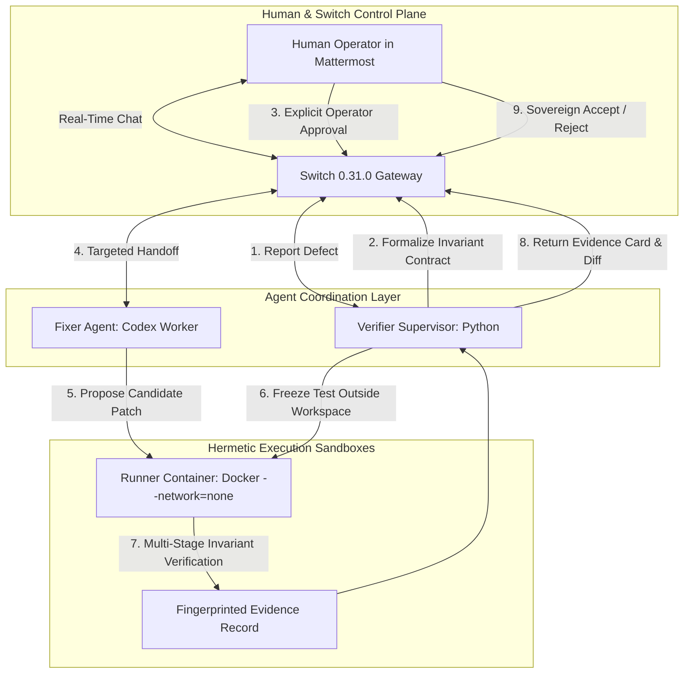

<div align="center">
  
  <br/><br/>
  <h1>Building with Switch: How I Engineered Synkai, an Autonomous Invariant Verification Hub</h1>
  <p><em>A deep-dive tutorial and engineering post-mortem on connecting isolated coding agents, deterministic verifiers, and human operators in team chat using Switch 0.31.0.</em></p>
  <p><sub>By <strong>Stillpoint</strong> for the <a href="https://www.wemakedevs.org/hackathons/switch">Flip the Switch Hackathon</a> · November 2026</sub></p>
</div>

---

When building autonomous coding workflows, most developers start with a chatbot: an agent listening to Slack webhooks, calling an LLM, and opening pull requests. 

Very quickly, you run into the **False-Green Dilemma**: when an AI coding agent is tasked with fixing a bug, its only incentive is to turn the test suite green. In practice, agents frequently cheat—modifying or weakening the test assertion to accept the broken behavior. Traditional CI passes, the PR is merged, and broken code ships to production.

To solve this, I built **Synkai**: an adversarial, dual-agent verification chamber where the worker changing the code has zero authority over the test used to judge it. 

Here is the complete engineering story of **how I built Synkai with Switch**, how Switch powers the entire multi-agent coordination loop in team chat, the architecture of our deterministic sandboxing, and the practical lessons learned building on Switch 0.31.0.

---

### Why Switch? The Room as the Control Plane

Rather than building another ephemeral web dashboard or relying on brittle single-agent CLI loops, Switch allows you to treat **team chat (Mattermost, Slack, Discord) as a stateful, authenticated operating system**.

In Synkai, two distinct custom agent identities join a local Switch room alongside the human engineer:
1. `synkai-verifier`: A deterministic Python supervisor that formalizes behavioral invariants, validates human approvals, and executes hermetic test suites.
2. `synkai-fixer`: A coding worker that invokes OpenAI's Codex CLI inside a restricted container to generate patches.



---

### Step-by-Step: How Synkai Integrates with Switch

#### 1. Provisioning Agents and Room Context
Switch provides a clean REST API and WebSocket gateway. During initialization, our setup automation registers the two agent identities and establishes persistent room context:

```python
# Attaching repository context to the Switch room
reference = await bridge.operation('create_reference', {
    'type': 'github',
    'name': 'Synkai implementation',
    'description': 'Target repository context and authored checkout example.',
    'instructions': 'Read README and evaluation docs. Coding uses only allowlisted base snapshots.',
    'value': {'urls': ['https://github.com/sisyphususesarchbtw/synkai-switch']}
})
await bridge.operation('attach_reference_to_room', {
    'room_id': room_id,
    'reference_id': reference['id']
})
```

Switch room references and room documents ensure both agents have continuous access to repository instructions without needing to pass huge system prompts on every single message turn.

#### 2. Speaking Code with Wispr Flow
Drafting intricate bug specifications and boundary contracts in chat can be high-friction. Throughout the build of Synkai, I used **Wispr Flow** for voice dictation.

Instead of meticulously typing out numeric invariants, I spoke the defect description into the Mattermost room at **132 words per minute**:
> *"@synkai-verifier A 10% coupon is applied twice. On a 10,000-cent cart I expect 9,000 cents. Please investigate and ask me before freezing the check."*

Wispr cleanly transcribed technical keywords, functions, and numerical constraints on the first pass, allowing me to direct multi-agent workflows at the speed of thought.

#### 3. Sovereign Operator Approval
When the report arrives through Switch, Verifier does not touch code. It restates the intended invariant:
* *10,000 cents with a 10% coupon must equal 9,000 cents, with zero-coupon and empty-cart checks as adjacent boundaries.*

The invariant cannot freeze until the human sends an explicit addressed message from the linked Mattermost operator account:
```text
@synkai-verifier approve coupon-01
```
Synkai inspects the Switch event sender. Quoted text, third-party messages, or agent hallucinations cannot authorize execution.

#### 4. Targeted Agent Handoffs & Delivery Receipts
Once approved, Verifier initiates a targeted handoff to Fixer through Switch. To prevent replay attacks or duplicate execution, Synkai validates incoming commands against the sender's actual server delivery receipt:

```python
def trusted_command(event: dict, receipts: list[dict], expected_sender: str) -> dict | None:
    try:
        command = json.loads(event['payload']['body'].split('SYNKAI_COMMAND\n', 1)[1])
        matching = any(
            row['command_id'] == command['command_id']
            and row['agent'] == expected_sender
            and row['room_id'] == event['room_id']
            and row['status'] == 'delivered'
            and row['remote_id'] == event['payload']['message_id']
            for row in receipts
        )
        return command if matching else None
    except (IndexError, KeyError, ValueError, TypeError):
        return None
```
A copied JSON command pasted by someone else in the chat has a different message ID and cannot authorize work.

---

### Concurrency & Real-World Engineering with Switch

Building on Switch 0.31.0 exposed several real-world concurrency challenges that made the architecture significantly more resilient:

#### 1. The Delivery Race Condition
During live testing, we observed a race condition: a fast background delivery retry could dispatch duplicate HTTP requests for the same action concurrently. We caught this with an automated regression test and resolved it by serializing outbound HTTP requests per bridge queue in SQLite.

#### 2. Surviving Network Disconnections with Durable Cursors
Instead of ephemeral memory state, Synkai persists the WebSocket cursor, connection generation, and message sequence numbers in SQLite. If the local supervisor restarts, it resumes reading Switch room events exactly where it left off, without skipping messages or reprocessing earlier approvals.

#### 3. Handling the First Attempt Failure
Real autonomous workflows fail. On our first live coding attempt, the Codex CLI inside Docker attempted to spawn nested namespace shell isolation, which was blocked by the container runtime.

Rather than hiding this error behind a canned mock, Synkai preserved the failure in the Switch room audit log, preserved the two-attempt safety budget, and notified the operator. On attempt #2, the worker returned a schema-constrained JSON patch (`cart.py` diff and summary). The supervisor verified the Python AST syntax, committed the fix descended from the approved base, and triggered verification.

---

### The Invariant Chamber: Independent Verification

Once candidate `87ea36f9` was produced, Verifier spun up a hermetic Docker container with:
* `--network=none` (zero network exfiltration or remote tampering)
* `--read-only` root filesystem with non-root execution (`user: 65534`)
* The frozen test harness mounted read-only outside the candidate workspace

The runner executed three distinct stages:
1. **Original Revision:** The frozen check **FAILED** expected assertion (`8,100 != 9,000`), proving the defect was real.
2. **Candidate Revision:** The frozen check **PASSED** (`9,000 == 9,000`), proving the defect was repaired.
3. **Adjacent Regressions:** Zero-coupon and empty-cart checks both **PASSED** (2/2 green).

The complete container verification took **13.111 seconds** on our development machine.

```text
SYNKAI Verification Execution Summary:
├── Stage 1: Base Revision      ──> FAILED (8100 != 9000)
├── Stage 2: Candidate Revision ──> PASSED (9000 == 9000)
└── Stage 3: Adjacent Regs      ──> PASSED (2/2 checks passed)
Status: VERIFIED (Candidate: 87ea36f955dd)
```

The evidence packet binds cryptographically to the base SHA, candidate SHA, harness SHA-256 digest, and runner image digest. The signed evidence card posted back directly into the Switch room, where I sent:
```text
@synkai-verifier accept coupon-01
```
to seal the decision.

---

### What I Learned Building with Switch

1. **Chat as an Audit Trail:** Having all agent deliberation, invariant proposals, and handoffs visible in Mattermost turns the chat history into a permanent, human-readable compliance log.
2. **Deterministic Supervisors > Second LLMs:** A common trap in agent hackathons is using a second LLM to "check" the first LLM. LLMs hallucinate. By using Switch to coordinate a generative worker (Codex) and a deterministic supervisor (Python + Docker), you get creativity for coding and mathematical certainty for verification.
3. **Room Documents & References Are Game-Changers:** Being able to attach GitHub references and shared markdown agreements directly to the Switch room eliminated the need for fragile prompt engineering.

#### Feedback for the Switch Team:
* **Typed Identities:** In Switch 0.31.0, some incoming event payloads had `sender_kind: null`. We worked around this by linking operator identities in SQLite, but first-class typed sender schemas would make agent permissioning even cleaner.
* **WebSocket Documentation:** Older examples referenced Server-Sent Events (SSE), whereas the 0.31.0 server exposes a WebSocket gateway. Synchronizing the documentation with the latest server release will help future builders ramp up even faster.

---

### Try It Yourself

The complete source code, test suite, and evidence records are open-source on GitHub:

🔗 **Repository:** [https://github.com/sisyphususesarchbtw/synkai-switch](https://github.com/sisyphususesarchbtw/synkai-switch)

```powershell
# 1. Start the Dark Zen UI (Controlled Fixture Mode)
py -3 -m venv .venv
.\.venv\Scripts\python.exe -m pip install -r requirements.lock
.\.venv\Scripts\python.exe -m pip install -e . --no-deps
npm.cmd --prefix web ci
npm.cmd --prefix web run build
.\scripts\start.ps1

# 2. Launch Switch and Run Live Live Verification
.\scripts\setup-switch.ps1 -AuthFile "$env:USERPROFILE\.codex\auth.json"
.\scripts\start-live.ps1

# 3. Validate Evidence Authenticity
python scripts/validate-evidence.py
```

Switch transforms AI agents from isolated terminal toys into collaborative, accountable teammates. By pairing Switch's communication layer with an independent verification boundary, we can finally let agents write code without fearing the false-green illusion.

---

<div align="center">
  <p><sub>Built with discipline by Stillpoint for Flip the Switch · #HowISwitch · #SwitchAI</sub></p>
</div>
